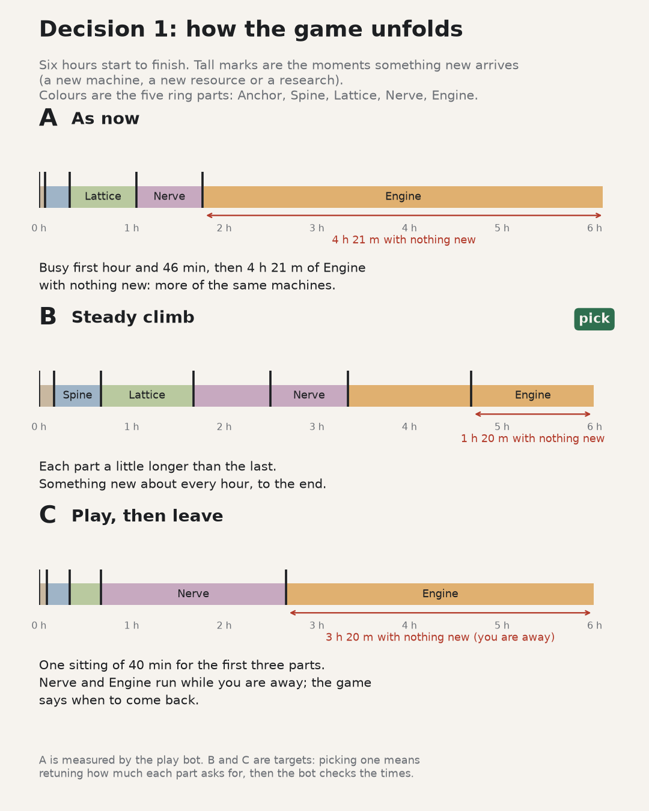
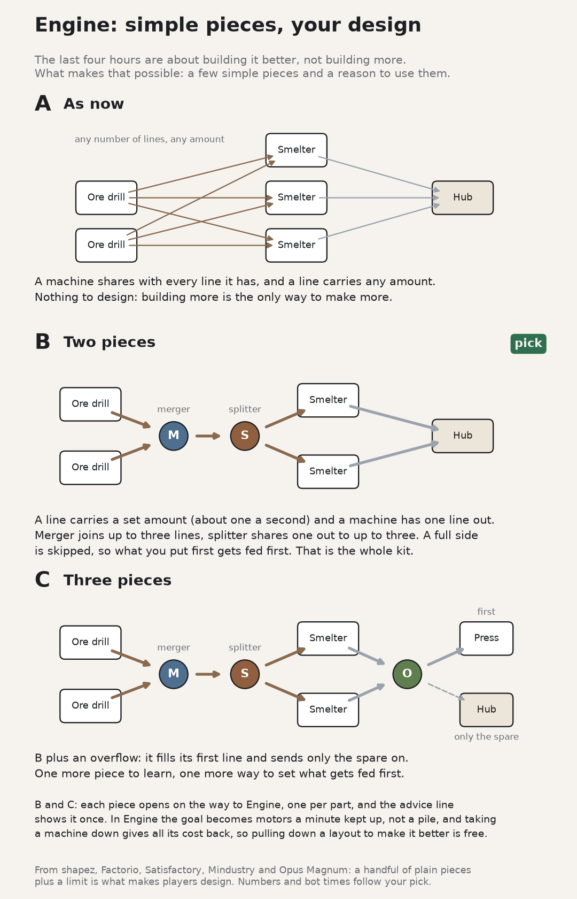
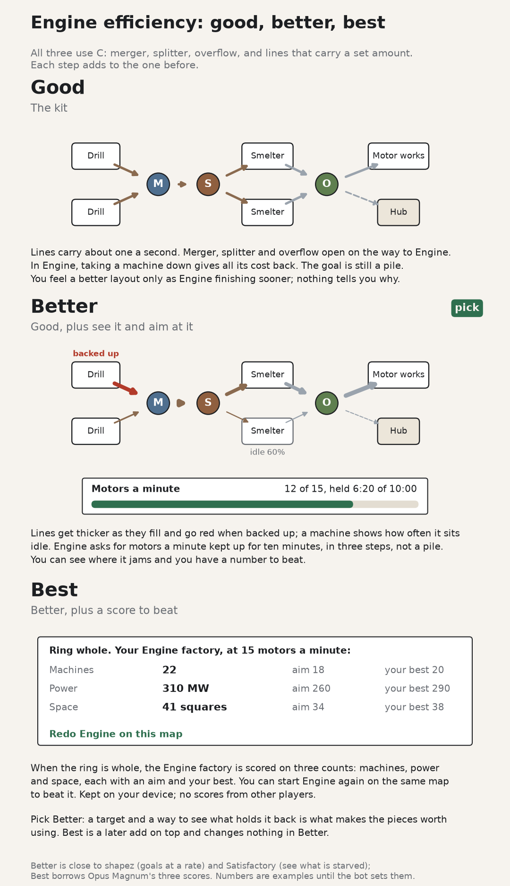
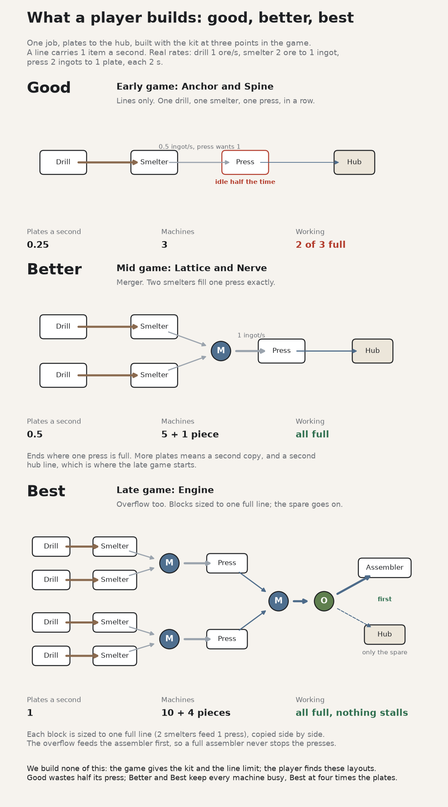
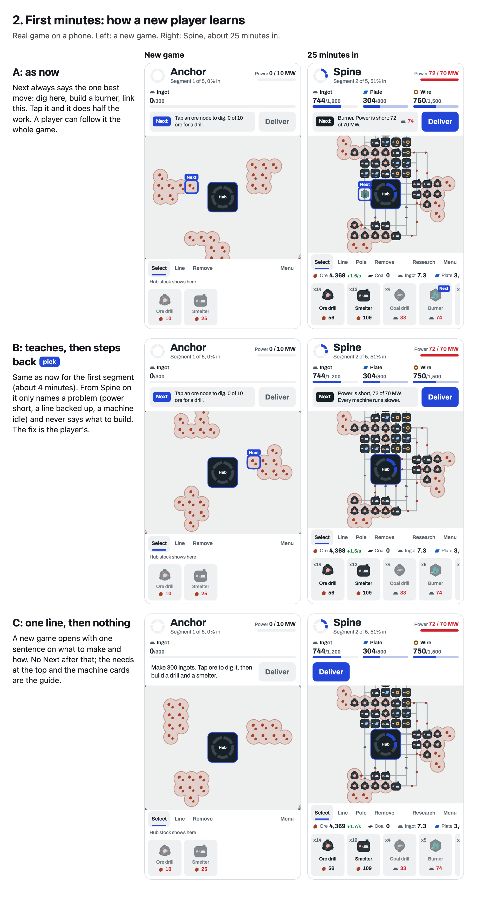
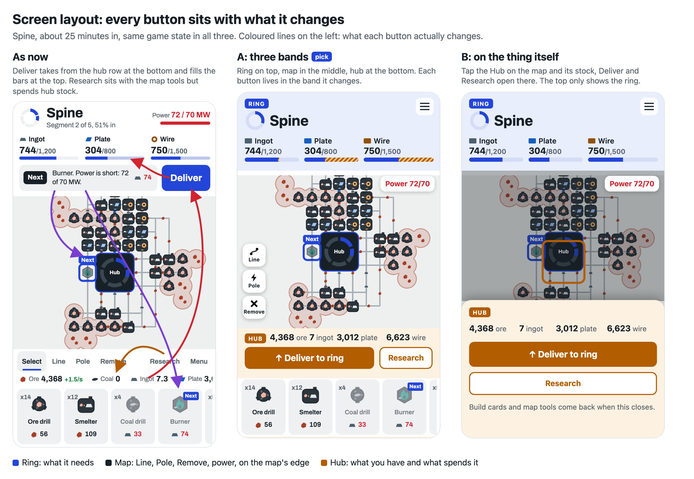
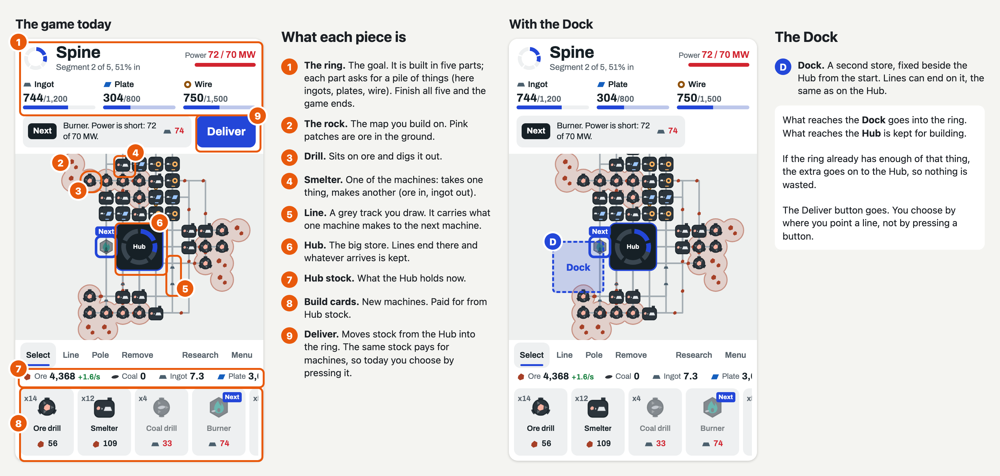

# UX pass: the flow of decisions

Byron, 2026-11-09 (#19364898), after the ten-piece design system run: "we need to figure out the
flow of decisions. Maybe we do UX now and then fix up the skill later depending on how that goes."
So this pass is two things: the game's UX, and a trial of how design decisions should flow. The
design-hitl skill is written from what this pass teaches (management G124).

## How decisions flow in this pass

Taken from the lessons of the design system run (bot msg 1559), to be tested here:

1. Agree the list and its order first (this file), big to small: what the player does before how
   it looks.
2. Per decision, write the steps and states in plain words and get a yes before drawing anything.
3. Then one picture per decision, from the real game: as now, the simplest, and at most one more.
   The pick leans toward less.
4. His answer goes in the game, then the next decision.
5. At the end, one before/after of the whole game and a play-through.

## The decisions, big to small

| # | Decision | Status |
| --- | --- | --- |
| 1 | The whole game: how it unfolds over six hours (pacing), not a screen | set: front half as now; Engine an efficiency stage from kit C (merger, splitter, overflow, lines carry a set amount); lines show load, machines show idle, Engine asks for a rate held; built after decisions 5 and 6 |
| 2 | First minutes: how a new player learns what to do (the advice line as now, a few guided steps, or nothing) | drawn, A/B/C sent |
| 2b | Screen layout: every button sits with what it changes (Byron, #19364907) | A/B sent; Deliver to go, Ring dock written in steps (#19364909) |
| 3 | Building: pick a machine, place it, place again, cancel | proposed |
| 4 | Connecting: drawing a supply line from one machine to another, and undoing it | proposed |
| 5 | Trouble: from seeing a problem to fixing it (tap, Next, the fix) | proposed |
| 6 | Goals: knowing what to make next, delivering, the map growing, and where the player sees the road ahead (the ring list, 1-road.png) | end goal set: mine the land (#19364920), steps await a yes |
| 7 | Research: what it unlocks and when you see it | proposed |
| 8 | Coming back: the away summary and picking up where you were | proposed |
| 9 | Menu: save, new game, settings | proposed |

Byron, 2026-11-09 (#19364899), on the order: "Maybe the first one should show the overall
progression steps needed to complete the game". Added as decision 1; the rest move down one.

## 1. The whole game

The road today (from `src/game.js`, times from `sim/balance.mjs`):

| Segment | Asks for | Opens | Done by |
| --- | --- | --- | --- |
| Anchor | 300 ingots | ore drill, smelter (from the start) | 4 min |
| Spine | ingots, plates, wire | coal drill, burner, press, wire drawer | 20 min |
| Lattice | frames, concrete | quarry, kiln, assembler, turbine | 1 h 3 min |
| Nerve | circuits, frames, wire | quartz drill, refinery, fabricator | 1 h 46 min |
| Engine | motors, circuits, concrete | solar field, motor works | 6 h 7 min |

Then the ring is whole and the rock leaves.

What the player sees now: the five-arc ring in the top bar, and only the current segment's parts.
The four ahead have no names until reached.

Proposed steps, for Byron's yes:

1. Tap the ring in the top bar: a list of all five segments opens.
2. Done segments are ticked. The current one shows its parts and progress.
3. Segments ahead show their name and the parts they ask for. The machines they open stay hidden
   until reached, so the build bar never shows locked clutter.
4. Close goes back to the map. A new game opens this list once, so the first thing a player sees
   is where the game ends.

Byron, 2026-11-09 (#19364900), on the steps: "I want this to be visual". So the list is drawn,
`1-road.png` (real phone, `?demo=3`, Lattice under way, made by `1-road-shots.cjs` and `1-road.html`):

- A: as now, the small ring in the top bar and only the current segment.
- B: tap the ring, a road top to bottom. Done stops ticked; the current one with its parts and bars;
  ahead stops with their parts as item shapes and the machines they let you build as greyed
  pictures; ends at "The rock leaves". (pick)
- C: tap the ring, the ring drawn big and filling, the parts each segment needs listed below with
  item shapes; no machines.

Byron, 2026-11-09 (#19364901), on the screen picture (1-road.png): "This is a ui thing. We're
talking about how we design the progression. Something a user wouldn't see but they would
experience". So decision 1 is the pacing itself. Where the road is shown moves to decision 6.

### The progression, drawn

Tall marks are moments something new arrives: a machine, a resource or a research.

- A, as now (bot, 15 s checks): parts done at 4 m, 20 m, 1 h 3 m, 1 h 46 m, 6 h 7 m. Every new
  thing comes with a part, so Engine is 4 h 21 m of building more of the same.
- B, steady climb: parts done at about 10 m, 40 m, 1 h 40 m, 3 h 20 m, 6 h. Each part a little
  longer than the last, and Nerve and Engine each open one research part way through, so
  something new arrives about every hour. Longest stretch 1 h 20 m.
- C, play then leave: the first three parts in one 40 min sitting, then Nerve and Engine sized
  to run while the player is away, with a "come back in about 2 h" line. Same six hours.

Pick B: closest to the six-hour game with some idle time that was asked for, and it is numbers
only (what each part asks for, when two research open); C needs a new come-back feature. After
the pick, the parts are retuned and the bot checks the times.

Drawn with `docs/ux/1-progression.py`.

Byron, 2026-11-09 (#19364902), on 1-progression.png: "I like the idea of getting to engine
quickly. But we need some creative freedom enabled so people can work on efficiency for the last
4 hours."

So the front half stays as A (Engine reached at about 1 h 46 m), and the last four hours become
an efficiency stage instead of more of the same. Today in Engine the only levers are more
machines (each costs 13% more than the last), the Line balancing research, and removing a
machine gives half its cost back, so rebuilding a layout is punished. Options, for his pick:

- A: other recipes. Engine opens two or three second ways to make the same part (a motor from
  plates and wire with no ingots; circuits with more wire and no silica). Each is cheaper in one
  thing and dearer in another, so the best mix depends on the player's map. (pick)
- B: rate goals. Engine asks for a rate held, not a pile: motors a minute kept up for ten
  minutes. A tidier factory finishes sooner; the end screen keeps the best time.
- C: free rebuild. In Engine, removing a machine gives its full cost back and the map opens
  wider with richer patches further out, so tearing down and laying out again pays.

Pick A, with C's full refund in Engine as well since it is one number: recipes give the choices,
the refund makes trying them free. Numbers and bot times follow his pick.

Byron, 2026-11-09 (#19364903), on those options: "I'm thinking more base components like
splitters and mergers. Maybe have a look at other incremental game progressions to see how simple
components can enable creativity in regards to efficiency. I prefer low complexity base with the
player able to design complex systems from simple base components". So recipes (A above) are set
aside; the Engine stage is built from a small kit of pieces.

### What other games do

| Game | The base pieces | What turns them into design |
| --- | --- | --- |
| shapez | belt, splitter/merger (one balancer), tunnel, then cutter, rotator, stacker, painter | belts carry a fixed amount, so goals at a rate force splitting work across copies; goals are shapes, so the same few pieces are rearranged for each |
| Factorio | belt, inserter, splitter, underground | belt and inserter speed limits; splitters chained make balancers, a whole player craft built from one piece |
| Satisfactory | belt, splitter, merger, later smart and programmable splitters (overflow, filter) | belt tiers and exact machine rates: players chase 100% use with manifolds and overflow, and free dismantle makes rebuilding normal |
| Mindustry | conveyor, junction, router, sorter, overflow gate, bridge | the overflow gate gives priority (feed this first, spare goes on), which most clever layouts lean on |
| Opus Magnum, Infinifactory | a handful of arms and parts | no new parts late; each puzzle is scored on cost, time and size against everyone else, so the challenge is doing better, not more |

The pattern: the kit stays small and arrives early, and efficiency comes from a limit the pieces
work against (a line that carries only so much) plus a goal that rewards a better layout (a rate
held, or a score). Today neither exists here: a machine already shares its output over any number
of lines and a line carries any amount (`src/world.js` `send`), so a splitter or merger would do
nothing until lines have a limit.

### Options, drawn

Drawn with `docs/ux/1-pieces.py`.

- A: as now. Any number of lines, any amount; building more is the only lever.
- B: two pieces. A line carries a set amount (about one item a second) and a machine has one line
  out. Merger joins up to three lines into one; splitter shares one line out to up to three, and
  skips a side that is full, so what is placed first is fed first. (pick)
- C: three pieces, B plus an overflow: it fills its first line and sends only the spare on.

B and C both: one piece opens per ring part on the way to Engine (splitter with Spine, merger with
Lattice, overflow in C with Nerve) and the advice line shows it once. In Engine the goal becomes
motors a minute held for ten minutes rather than a pile, and demolishing in Engine refunds the full
cost, so a better layout is worth building and rebuilding is free.

Pick B: the smallest kit that still lets a player design. A splitter that skips a full side gives
most of what an overflow does, so C's third piece can follow later if play shows it is missed.
After the pick: line capacity and pieces in `src/world.js`, auto-link and the bot taught to use
them, then the bot checks the front half still lands Engine at about 1 h 46 m.

Byron, 2026-11-09 (#19364904), on 1-pieces.png: "Yea this is getting there. I like c. Draw up what
good better best would look like in terms of system design for efficiency". So the kit is C:
merger, splitter, overflow, and lines that carry a set amount.

### Good, better, best

Drawn with `docs/ux/1-tiers.py`. Each step adds to the one before.

- Good, the kit: line limit, one line out per machine, the three pieces opening on the way to
  Engine, full refund on demolish in Engine. The goal stays a pile, so a better layout is felt only
  as Engine finishing sooner, with nothing saying why.
- Better, see it and aim at it: lines thicken as they fill and go red when backed up, each machine
  shows how often it sits idle; Engine asks for motors a minute held for ten minutes, in three
  steps, instead of a pile. (pick)
- Best, a score to beat: when the ring is whole the Engine factory is scored on machines, power and
  space at its motors-a-minute rate, each with an aim and the player's best (Opus Magnum style),
  plus "Redo Engine on this map". Local only, no shared scores.

Pick Better: the target and the view of what holds it back are what make the pieces worth using.
Best sits on top of Better without changing it, so it can follow. Numbers in the picture are
examples until the bot sets them.

Byron, 2026-11-09 (#19364905), on 1-tiers.png: "I'm talking about what a user wouldn't build. So
good would be what they build early game, better mid game and best late game". So good, better,
best are not three scopes for us to build; they are what a player builds with kit C as the game
goes on, and the kit and line limit are there so that climb exists.

### What a player builds

Drawn with `docs/ux/1-builds.py`, one job (plates to the hub) at real rates from `src/game.js`,
a line carrying 1 item a second.

- Good, early game (Anchor, Spine): lines only, drill to smelter to press in a row. The smelter
  makes 0.5 ingot a second and the press wants 1, so the press sits idle half the time. 0.25
  plates a second from 3 machines.
- Better, mid game (Lattice, Nerve): a merger lets two smelters fill one press exactly. 0.5 plates
  a second, every machine busy. It stops where one press and one line are full.
- Best, late game (Engine): blocks sized to one full line (2 smelters to 1 press), copied side by
  side, merged, and an overflow that feeds the assembler first and sends only the spare to the
  hub, so a full assembler never stops the presses. 1 plate a second from 10 machines and 4
  pieces.

The splitter's part (sharing one line of ore across smelters) is left out to keep the picture to
one idea per step. What the game itself provides for this stays as 1-tiers.png's Better: lines
show load and backups, machines show idle, Engine asks for a rate held.

Byron, 2026-11-09 (#19364906), on 1-builds.png: "Yes". Decision 1 is set. What goes in the game:
kit C (merger, splitter, overflow), a line carries a set amount and a machine has one line out,
the pieces open on the way to Engine, full refund on demolish in Engine, lines show load and
backups, machines show idle, and Engine asks for motors a minute held. Building waits until
decisions 5 (trouble) and 6 (goals) are set, since both decide how load, idle and the rate goal
are shown; then the bot checks the front half still lands Engine at about 1 h 46 m.

## 2. First minutes

Real phone shots: a new game, and Spine about 25 minutes in (`?demo=2`). Made by
`2-first-shots.cjs` and `2-first.html`.

As now, Next always names the one best move (dig here, build a burner, link this) and tapping it
does half the work, so a player can follow it the whole game. With decision 1's kit that would
also play the efficiency game for them.

- A: as now.
- B: teaches, then steps back. Next as now through Anchor (about 4 minutes). From Spine on it
  only names a problem (power short, a line backed up, a machine idle) and never says what to
  build. (pick)
- C: one line, then nothing. A new game opens with one sentence on what to make and how; no
  Next after that, the needs and the machine cards are the guide.

Pick B: the first minutes stay easy, and from Spine the layout is the player's, which is what
decision 1 is for. C leaves a new player stuck at the first burner.

## 2b. Screen layout

Byron, 2026-11-09 (#19364907), on 2-first.png: "I don't understand what is going on. Seems like
there is no coherence to placement and what buttons interact with what on the screen. The delivery
button is especially confusing. Work out a systematic system where panels match what they interact
with consistently. Also too much text". Taken ahead of decision 3, since every later screen sits in it.

As now, Deliver sits at the top but takes from the hub row at the bottom; Research sits with the map
tools but spends hub stock; the Next sentence at the top points at the map and a card at the bottom.

The rule: three bands, each owning one thing. Ring (top, blue): what it needs, nothing else. Map
(middle): Line, Pole, Remove and power on the map's own edge, Next as the marker on the map, no
sentence. Hub (bottom, orange): what the hub holds and everything that spends it: Deliver, Research,
build cards. Bars show the part Deliver would add, striped in the hub colour.

- A: three bands, always on screen. (pick)
- B: the hub's things open from the Hub on the map; the top only shows the ring.

Pick A: nothing is hidden behind a tap, and the rule reads from the colours alone. Shots are mock-ups
over the real game (`?demo=2`), made by `2b-panels.html` and `2b-panels-shot.cjs`.

Byron, 2026-11-09 (#19364908), on 2b-panels.png: "What is the reason we need a deliver button at
all?" None that holds: the ring and build costs share hub stock, so Deliver was meant as the moment
to hand parts over rather than build with them, but in play it lights up and gets pressed. Options
sent (bot msg 1582): A the ring takes needed parts from the hub by itself / B a Ring dock beside the
Hub from the start, anything a line brings it goes to the ring, the Engine rate goal is the dock's
rate (pick) / keep Deliver. Either way the hub band holds only stock, Research and build cards.

### The Ring dock, in steps

Byron, 2026-11-09 (#19364909), on bot msg 1582: "Ok well we need to design the mechanism before
we move on". Written in plain words first, per step 2 of the flow; drawn once it has a yes.

What it is: a Dock, 3 by 3 tiles, fixed beside the Hub from a new game, drawn in the ring colour.
Lines end at the Dock the same way they end at the Hub. The Deliver button goes.

The one rule: the Dock takes what the ring part still needs, and anything else goes on to the Hub.
Nothing is lost and no line backs up because of the Dock.

States:

1. No line in (a new game). Next points at the Dock: "link the smelter to the Dock".
2. Filling. Each need in the ring band shows a bar, the rate coming in, and time to full.
3. One need full. That line's items go on to the Hub; its bar shows full. Not a problem.
4. Ring part done. Short card: what the next part needs. Lines bringing something it does not
   need now feed the Hub, the same as state 3.
5. Engine. The bar becomes motors a minute against the goal, with the time it has held.
6. Ring whole. The end screen.

Actions: draw a line to the Dock, remove it (as any line), tap the Dock to see each need, its rate
and time to full.

The choice Deliver was meant to be moves into the layout: a machine's line goes to the Dock (ring)
or to the Hub (building), and from Spine the splitter shares it. Hub stock is for building and
Research only. Saves with stock in the Hub keep it for building.

### From the top

Byron, 2026-11-09 (#19364910), on bot msg 1584: "you're gonna need to explain it from the top. I
don't understand what any of those components are or how they work." So the pieces are named on a
real shot (`?demo=2`) before the Dock is asked about again.

Made by `2b-explain.html` and `2b-explain-shot.cjs`. The question stays the one from bot msg 1582,
in plain words: lines into a Dock decide what goes to the ring (pick), or the ring takes from the
Hub by itself, or keep the button.

## The one goal

Byron, 2026-11-09 (#19364912), on bot msg 1588: "I think we have to talk about the overall goal of
the game. What is the goal? There should only be one goal throughout the game".

The goal on paper (`docs/design.md`): finish the ring of five parts so the rock flies home. In play
the player is chasing four different things: piles for the ring (Anchor to Nerve), a rate for the
Engine (decision 1, a switch in the last four hours), hub stock for building and Research, and the
map growing. Deliver made it worse by asking the player to choose between the ring and building.

Proposed, one goal from the first minute to the last: get the rock home by feeding the ring.
Measured the same way all game, as parts a minute into the ring (the Dock).

- Each ring part asks for a rate of its part, held for a while: Anchor a few ingots a minute,
  Engine motors a minute. No switch from piles to a rate at the Engine.
- Everything else is a means: machines, lines, Research and the map growing exist only to raise
  that rate. The ring band shows one number against one target.
- Hub stock stays as what you build with, never a second score.

Options sent: yes (rate all game) / piles all game (simpler, but efficiency only matters as speed) /
something else in his words.

### An end goal that feeds itself

Byron, 2026-11-09 (#19364917), on bot msg 1607: "That's not a goal. There needs to be an end goal.
Look at games like moon sweepers where moving towards the goal also accelerates progress towards
the goal". In Moon Sweepers the end is clear (the whole Moon clean) and the act of cleaning is
also the income: dust swept is sold for better tools, so every step towards the end makes the next
step faster. A rate into the ring has no end and does not feed back.

Proposed:

- A: fly the rock home (pick). The end is a place: home, a set distance away, shown as one route
  bar with the rock on it. The ring is the engine: what reaches the Dock is thrust and moves the
  rock. As it travels it passes debris fields that drift into reach with new, richer patches, so
  distance covered means more to build with, more parts, more thrust. Ring parts become engine
  stages, each making a part push further. The game ends when the rock arrives.
- B: mine the rock out. The end is the whole rock dug (a percent cleared, like the Moon cleaned).
  Clearing ground is the income and opens new ground underneath, so digging pays for faster
  digging. Drops the ring story.

Pick A: keeps the ring and the rock flying home that the game already tells, and adds one number
the player watches all game (distance to home) that their factory visibly speeds up.

### More end goals, none about the rock

Byron, 2026-11-09 (#19364918), on bot msg 1609: "Stfu about the rock. Give me some more options".
Each option below has an end the player can see coming, and the thing that moves you towards it
also makes the factory faster.

- A: build the ship (pick). The end is a finished ship, five sections, and you leave. Each section
  you finish switches on something: a crane (build faster), a bigger generator, a scanner that
  finds richer patches, a second dock. Every section makes the next one quicker.
- B: bring the crew home. The end is 20 crew rescued. Parts buy rescue pods; each person rescued
  runs a machine for you, so rescues speed up rescues.
- C: light up the planet. The end is every district lit. Powering a district opens its ground and
  sends power back, so each lit district makes the next cheaper.
- D: pay off the debt. The end is a debt at zero. Parts sold pay it down and buy upgrades; the
  closest copy of the Moon Sweepers loop, one number going down.
- E: claim the whole map. The end is 100 percent claimed. Claimed land brings new patches, which
  pay for claiming more.

Pick A: one picture of the goal on screen, it reuses the five ring segments as ship sections, and
each step adds a new ability the player feels rather than only a bigger number.

### Set: mine the land

Byron, 2026-11-09 (#19364920), on bot msg 1611: "I think mine the land is a good one. Lore is that
you are stationed there for mining". That is E (claim the whole map), told as a mining posting.

The goal in plain steps, for a yes before anything is drawn:

- Story: you are posted to this ground to mine it. The posting ends when the land is mined out.
- One number all game: land mined, as a percent, on one bar at the top. 100 percent is the end.
- Each ore patch holds a set amount. Drills empty it; an empty patch counts as mined.
- Mining pays: what you dig and make buys machines and opens the next stretch of land, which has
  more and richer patches. So every patch mined makes the next one faster (the Moon Sweepers loop).
- The ring stops being the goal. What it unlocked today (new land, new machines) comes from land
  mined instead; the ring and Deliver go, and with them the Dock question (2b).
- Hub stock stays what you build with, never a score.

Open after the yes: how big a patch is, how land opens (in rings as today, or by choosing where
next), and what the end screen says.
